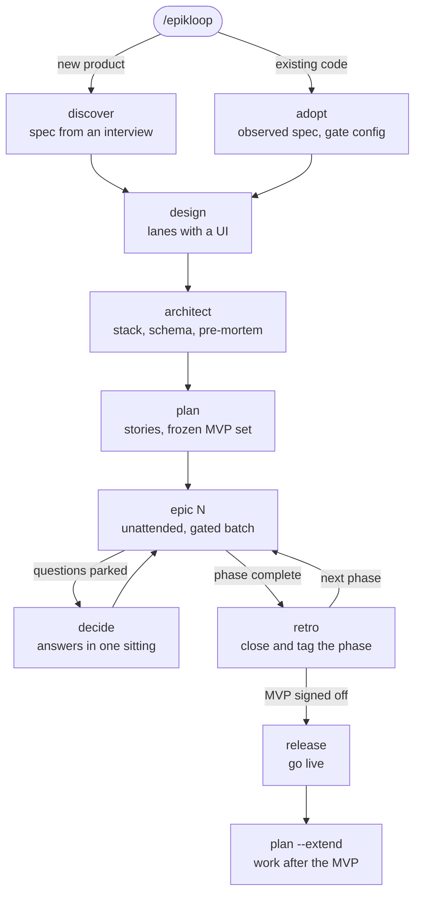
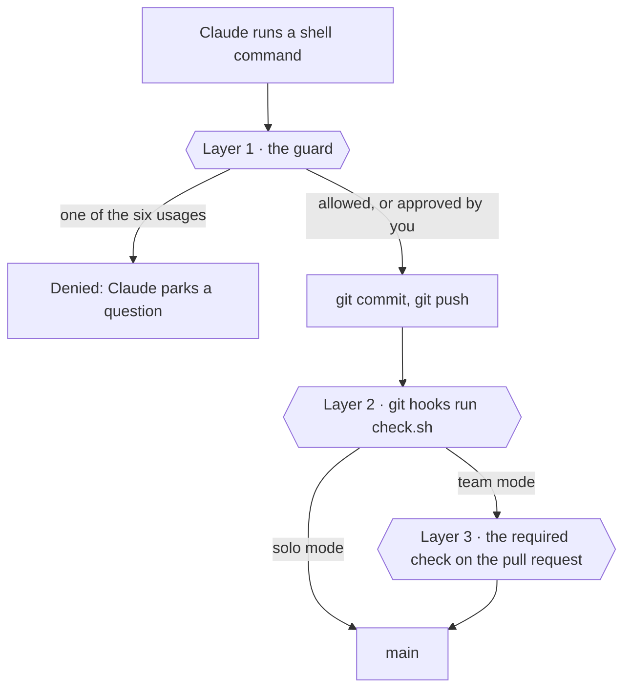

<h1 align="center">
  <picture>
    <source media="(prefers-color-scheme: dark)" srcset=".github/assets/banner-dark.svg">
    
  </picture>
</h1>

<p align="center">
  <b>Spec it, story it, run the epic unattended through hard gates, decide, run again, ship.</b>
</p>

<p align="center">
  <a href="https://github.com/Yheng/Epikloop/actions/workflows/ci.yml"></a>
  
  <a href="LICENSE"></a>
  
  
  
</p>

<p align="center">
  <a href="#install">Install</a> ·
  <a href="#quick-start">Quick start</a> ·
  <a href="#how-it-works">How it works</a> ·
  <a href="#commands">Commands</a> ·
  <a href="#configuration">Configuration</a> ·
  <a href="#documentation">Docs</a>
</p>

> [!IMPORTANT]
> **Epikloop is in pre-release.** This README describes the loop as it is designed. Today the
> marketplace installs, the [git guard](#the-git-guard) and the gates protect Epikloop projects,
> and every command but `design` and `harbor` has its full instructions. The lanes arrive with
> milestone 1. [Status](#status) shows what works now and when the rest lands.

## Contents

- [What Epikloop is](#what-epikloop-is)
- [Status](#status)
- [Install](#install)
- [Quick start](#quick-start)
- [How it works](#how-it-works)
- [Using Epikloop](#using-epikloop)
- [Commands](#commands)
- [Gates](#gates)
- [Files and state](#files-and-state)
- [Configuration](#configuration)
- [Harbor](#harbor)
- [Limits](#limits)
- [Development](#development)
- [Roadmap](#roadmap)
- [Documentation](#documentation)
- [Contributing](#contributing)
- [License](#license)

## What Epikloop is

Epikloop is an agentic delivery workflow for Claude Code, distributed as two Claude Code plugins.
It takes a product to production, starting from an idea or from an existing codebase.

- It moves through a fixed set of phases: discover or adopt, design, architect, plan.
- It then runs a loop of autonomous batches of stories, and every story passes deterministic gates.
- Human questions are parked and answered in batches.
- Progress is measured against a frozen finish line, with a computed ETA.

The core plugin, `epikloop`, is the whole pipeline. The second plugin, `epikloop-harbor`, is
optional: a local 3D view of your projects, drawn from files Epikloop already writes.

### Principles

The pipeline enforces seven principles in product work ([doctrine](docs/doctrine.md)):

| Principle | In practice |
|---|---|
| **Laws, not rules** | Anything mechanically checkable (secrets, hardcoded visual values, lint, types, tests, build) is enforced by a script at commit and push, never by a prompt rule. |
| **Batch the human** | The build loop never stops to ask. Questions are parked with a conservative default taken, and you answer them in one sitting. |
| **Route findings by threshold** | Small mechanical fixes happen now, product calls become parked questions, and real but non-MVP issues become one backlog line. Nothing is filed by default. |
| **Risk-tiered verification** | Most stories need passing gates and acceptance evidence. Auth, money, migrations on live data and untrusted input also get an adversarial pass and your review of the diff. |
| **A frozen finish line and a fuel gauge** | The MVP set is frozen at plan time, every status opens with the fuel gauge, and the finish line moves only by a recorded decision. |
| **All state in files** | State lives in the repository or in files, never in a conversation, so a power outage, a new teammate or a six-week pause recover the same way. |
| **The immune system** | Every rule cites the failure it fixes. Every retro deletes something from the pipeline or says why nothing qualified, and prompt text has a hard ceiling. |

### How it differs

Compared with Spec Kit, OpenSpec, BMAD and Superpowers, Epikloop leads with the unattended batch:

- Mechanical rules are enforced by scripts the model cannot talk past.
- The human is interrupted at most twice a day.
- Scope can only grow by a recorded human decision.

## Status

Epikloop is built milestone by milestone, and each milestone is usable on its own.

| Piece | Status |
|---|---|
| The marketplace and both plugin manifests | **Available** |
| The git guard, a PreToolUse hook on the Bash and PowerShell tools | **Available** |
| The emitter: the event log, cost rows, and each story-worker's effort set from its tier | **Available** |
| JSON Schemas for the project marker, events, cost rows and user settings | **Available** |
| The gate runner: `scripts/check.sh`, its git hooks, and the secret and token gates | **Available** |
| The SessionStart briefing: the fuel gauge, the stage, the next step, the protocol, and arming the git hooks | **Available** |
| The project file formats, their templates, and the reader that derives stage and gauge from them | **Available** |
| Project setup: the project marker with its id, and the gate files, staged and armed | **Available** |
| CI: validation, the guard's, the briefing's, project setup's and the gate runner's self-tests, and the emitter's tests on Linux, macOS and Windows | **Available** |
| The path to a frozen plan: `/epikloop`, `discover`, `architect` and `plan`, with full instructions | **Available** |
| The batch: `epic`, `next`, `story`, the `story-worker`, `decide` and `triage`, with full instructions | **Available** |
| Closing the loop: `retro`, `release`, `adopt` and `doctor`, with full instructions, the staging smoke, and `init.mjs --refresh` | **Available** |
| The `web` and `service` lanes | M1 |
| `design`: direction variants, every screen, the gallery | M2 |
| Parallel story workers, the story-size law, the `mobile-expo` and `mobile-flutter` lanes | M3 |
| Harbor (its server, its 3D view and the `harbor` command), then the Bridge | M4 |

Until M1 lands, there are no lanes and no team-mode workflow, and the loop hasn't yet taken a real
project end to end, so Epikloop is not ready for real projects. See the [roadmap](#roadmap).

## Install

### Requirements

- Claude Code 2.1.295 or later
- Node 22 or later
- git

Linux, macOS and Windows are equal targets. The guard covers both the Bash and the PowerShell
tools, so Windows works with or without Git Bash. Team mode runs its required check on GitHub.

### Install the plugins

In Claude Code:

```
/plugin marketplace add Yheng/Epikloop
/plugin install epikloop@epikloop
```

Or from a terminal:

```
claude plugin marketplace add Yheng/Epikloop
claude plugin install epikloop@epikloop
```

Epikloop is meant to be installed at user scope, which `claude plugin install` uses by default:
nothing of the tool is committed into your repositories.

Harbor is a second, optional plugin, and it depends on the core one:

```
/plugin install epikloop-harbor@epikloop
```

### Update or remove

```
claude plugin marketplace update epikloop
claude plugin update epikloop@epikloop
```

Restart Claude Code to apply an update. To remove Epikloop, uninstall Harbor first if you have it,
then the core plugin:

```
claude plugin uninstall epikloop-harbor@epikloop
claude plugin uninstall epikloop@epikloop
```

In a session, `/plugin` opens the plugin manager. Uninstalling leaves your repositories' Epikloop
files and `~/.epikloop/` in place.

### Check the install

- `/epikloop:doctor` checks Node, git and Claude Code against their minimum versions, and your
  account's prompt-cache setup. Inside a project, it also checks the project files, the git hooks,
  the gate files against the plugin's current ones (`init.mjs --refresh` brings them up to date)
  and whether the emitter is writing this session's events. It says how to fix what it finds. The
  lanes this machine can build join the report with the lanes, and Harbor's reachability with
  Harbor.
- `claude plugin details epikloop` lists the plugin's components and its projected token cost.

## Quick start

Open Claude Code in a repository and run:

```
/epikloop
```

It tells you where the project stands and the one next step: `discover` for a new product, or
`adopt` for existing code. Say "go" and it starts that step. It is the only command to remember;
each time you come back, it works out the next step the same way.

## How it works

### The loop



### The stage machine

`/epikloop` works out the next step from the repository itself. Each stage has a mechanical
done-test, and the next step is the first one that fails, so the answer is the same after lunch or
after six weeks.

| # | When | Next step |
|---|---|---|
| 1 | The repository is not an Epikloop project yet | `discover` for a new product, or `adopt` for existing code |
| 2 | `spec/` is missing, or `observed` requirements are unconfirmed | Finish `discover` or `adopt` |
| 3 | The lane has a UI and `design/manifest.md` is missing, or `audit` reports gaps | `design`, from M2; until then a UI lane goes on to `architect` |
| 4 | `spec/architecture.md` is missing | `architect` |
| 5 | There are no stories, or the MVP set isn't frozen | `plan` |
| 6 | The current phase has unticked MVP stories | `epic N`, or `decide` first when a question blocks one of them or five or more wait |
| 7 | The current phase is complete but not tagged | `retro` |
| 8 | Every MVP epic is tagged, and there is no `mvp` tag | `retro` for the MVP sign-off, which waits until queue Δ ≤ 0 and the staging smoke is green |
| 9 | There is an `mvp` tag but no `live` tag | `release` |
| 10 | There is a `live` tag | Post-MVP mode: the backlog becomes visible, `epic N` runs planned work, and `plan --extend` takes new work |

### The session briefing

Every session in an Epikloop project starts with a briefing for Claude, from a SessionStart hook
in the core plugin:

- **One line on where things stand:** the fuel gauge, the project, its lane and mode, the stage,
  the next command, and anything that needs you. When the next command is one only you start,
  such as `retro` or `release`, the line says so, and Claude asks you to type it.
- **The protocol:** where the project's state lives, how a batch parks questions, and how findings
  are routed. It arrives by hook, so your `CLAUDE.md` keeps only your project's rules.
- **Arming:** when the repository carries `.githooks/` and nothing else owns git's hooks, the hook
  points `core.hooksPath` at `.githooks`. When another tool owns them, the briefing says so instead.

Outside an Epikloop project, Claude gets one line: "Not an Epikloop project. `/epikloop` to start."

### Stories and risk tiers

`plan` breaks the spec into epics and stories. Each story cites the requirement IDs it serves,
carries the spec delta it will apply, and has a tier that sets what its commit must carry:

| Tier | What the commit must carry | Default worker effort |
|---|---|---|
| T1, most stories | The gates and acceptance evidence | medium |
| T2 | T1, plus a test for each quoted business rule | high |
| T3: auth, money, migrations on live data, untrusted input | T2, plus negative-case tests from an adversarial reading of the change, frozen into the suite, and your review of the diff | xhigh |

You can change the effort for each tier; see [Effort and cost](#effort-and-cost).

### Batches and parked questions

`epic N` runs every ready story in epic N as one unattended batch:

- Each story runs in its own `story-worker` subagent, given only the story, the requirements and
  decisions it cites, and the files it touches. The orchestrator stays small and keeps no story's
  transcript.
- A story is built, passes its gates and is committed with its spec delta applied in the same
  commit, so there is no separate document-sync step.
- The commit lands: in solo mode it is pushed to the default branch, and in team mode it goes on
  its own branch with a pull request that you merge. In solo mode a T3 story also parks a
  `Review N.M` question, so you read its diff in `decide`.
- Workers run one at a time in one working tree until M3. A batch starts only from a clean
  checkout of the default branch, and it stops when a story doesn't land.
- The batch never stops to ask. A question is parked in `docs/queue.md` with a conservative default
  taken, and the work goes on.
- A story that outgrows its budget is parked as "split me". From M3, the story-size law enforces
  this mechanically.
- The batch ends with the fuel gauge and what needs you.

Every finding, whether the batch makes it or you report it with `triage`, goes through one
threshold router:

| The finding | Where it goes |
|---|---|
| Mechanical and small | Fixed now, in its own commit |
| Needs a product call | A parked question |
| Real, but not MVP-breaking | One dated backlog line in `docs/queue.md` |
| Breaks an MVP acceptance criterion | Fixed now, or an explicit scope question |

Nothing is filed by default. `decide` then takes you through the parked questions in one sitting:
each arrives with the default the loop took and what it blocks, each answer becomes a
`DECISION-XXX` entry in `docs/decisions.md`, and any work built on an overturned default goes back
for rework.

### The fuel gauge

Every status opens with one line:

```
MVP done/total · velocity · ETA · queue Δ
```

- **MVP done/total** counts the stories in the MVP set, which `plan` freezes. The total moves only
  by a recorded decision.
- **velocity** and **ETA** say how fast stories are closing and when the MVP set will be done at
  that pace. The hours per day you work on the project are an input.
- **queue Δ** says how the queue of questions and backlog lines is changing. While it is positive,
  the ETA is declared fiction, out loud.

One epic is one phase: `retro` closes it and tags it `phase-N`. Velocity counts MVP stories closed
over the last 14 days. The ETA divides the remaining stories' average worker wall time per tier by
your hours per day. Queue Δ counts from the start of the current phase, and at MVP sign-off from
the start of the final phase. The exact rules are in
[the formats](docs/formats.md#the-fuel-gauge).

### Lanes

A lane is a profile for one kind of product: `lanes/<name>.json` inside the core plugin, plus an
optional skill fragment. It declares:

- how visual truth is stored and gated
- how UI is verified: a Playwright screenshot, a Maestro or Flutter integration test, or contract
  tests
- how staging works: a host's git-deploy URL, an EAS preview, TestFlight or the Play internal
  track, or a service URL
- the performance budgets

The 1.0 lane set is `web` and `service` (which skips design) in M1, then `mobile-expo` and
`mobile-flutter` in M3. Native iOS and Android are community lanes. Contributors add lanes without
touching skills, and `/epikloop:doctor` reports which lanes your machine can build.

More in [Architecture → Stage machine](docs/architecture.md#stage-machine) and
[Lanes](docs/architecture.md#lanes).

## Using Epikloop

`/epikloop` recommends each step below in turn, so you can follow it instead of this list. Every
step is also a command you can run directly.

### A new product

1. **Start.** Run `/epikloop` and say "go" to start `discover`, or run `/epikloop:discover`
   directly. Paste a brief after the command if you have one, and only the gaps are asked.
2. **Discover.** The product's intent becomes `spec/`, one file per capability. Every requirement
   gets a stable ID such as `REQ-AUTH-003`, business rules are quoted verbatim, and
   `.epikloop/project.json` marks the repository as an Epikloop project.
3. **Design**, for lanes with a UI. Put reference images in `design/refs/`, then run
   `/epikloop:design`. It drafts three directions of the system sheet as HTML; you pick one, and
   every screen follows at both widths, in four states, with real copy, alongside `tokens.css`,
   `manifest.md` and a gallery at `design/index.html`. Later, `amend`, `add`, `audit` and `ingest`
   change one thing at a time.
4. **Architect.** `/epikloop:architect` chooses the stack and writes `spec/architecture.md`: the
   schema as code, the API contract and a pre-mortem. It confirms the lane, and each choice that
   closes off an alternative becomes a `DECISION-XXX` entry in `docs/decisions.md`.
5. **Plan.** `/epikloop:plan` writes `docs/stories/<epic>.md`: epics and tiered stories, each
   citing its requirement IDs. It freezes the MVP set and records solo or team mode, your hours per
   day and the deadline. Epic 1 opens with scaffolding and gates (story 1.1) and staging (1.2).
6. **Build.** `/epikloop:epic 1` runs the epic as an unattended batch. `/epikloop:next` runs only
   the next ready story, and `/epikloop:story 2.3` runs one named story.
7. **Decide.** `/epikloop:decide` takes you through the parked questions in one sitting.
   `/epikloop` recommends it when a question blocks a story or five or more are waiting.
8. **Report what you find.** `/epikloop:triage "<what you found>"` routes your own findings through
   the same threshold router the batch uses.
9. **Close each phase.** `/epikloop:retro` gathers the phase's evidence:
   - the scripted staging smoke and your click-through
   - the deep gates, with end-to-end tests
   - the gates' self-test

   The full visual compare and the perf check join it with the web lane. The retro then prunes the
   queue with you, reviews the cost rows, and deletes something from the pipeline, or records why
   nothing qualified. It records all this in `docs/decisions.md` and tags the phase.

   In the final phase, it also takes you through MVP sign-off. Sign-off waits until queue Δ is 0 or
   below and the staging smoke is green.
10. **Release.** `/epikloop:release` runs the go-live story: the production environment, promotion
    from staging, a rollback note and a post-launch checklist. Production follows the hosting that
    `spec/architecture.md` describes, and the release is tagged `live`.
11. **Keep going.** After release the project is in post-MVP mode. The backlog becomes visible, and
    `/epikloop:plan --extend` plans new work without touching the frozen set.

### An existing codebase

`/epikloop:adopt` brings existing code into Epikloop without breaking its build:

- The code is read into `spec/`, with every requirement marked `observed`, and
  `spec/architecture.md` describes the system as built.
- Gate commands come from the project's own scripts. If a gate fails on today's code, the adoption
  stops before it commits and names the failing commands, so you can fix the code or narrow the
  command.
- It ends with one confirmation batch, in which you confirm, correct or retire the observed
  requirements.
- Design tokens will be extracted from the existing UI once `design` arrives in M2.

From there, `/epikloop` walks the same stages as for a new product.

### Working as a team

Team mode is the standard; solo mode is supported. You choose during `plan`.

- `.epikloop/project.json` is committed, so every teammate gets identical behaviour.
- Teammates are gated even without the plugin. `.githooks/` holds the gate runner and the two-line
  hooks that run it, and one entry in the stack's install step arms them.
- Team mode adds one workflow, `.github/workflows/check.yml`. It runs the same `check.sh` on pull
  requests (10-minute timeout, cancel-in-progress) as a required check under branch protection.
- Solo mode creates no workflow, and `check.sh` fails if a workflow appears that
  `gates.allow_workflows` doesn't list.
- Progress is derived, never stored. In solo mode a story is done when a `feat(X.X):` commit exists
  on main. In team mode it is done when a merged pull request references it; squash merges
  collapse commits, so pull request titles and `Closes #` are what count.
- In team mode each story gets its own branch, `story/X.X`, and a pull request titled like its
  commit. A story whose pull request is still open is in review, and the stories after it wait
  for your merge.

## Commands

The front door is `/epikloop`. Every other command is namespaced as `/epikloop:<name>`.

| Command | What it does | Effort | Started by |
|---|---|---|---|
| `/epikloop` | The front door: syncs, detects the stage, shows the fuel gauge and what needs you, recommends one step and starts it on "go" | low | you or Claude |
| `/epikloop:doctor [--check]` | Checks that this machine can run Epikloop and says how to fix what is missing; `--check` also runs the gates | low | you or Claude |
| `/epikloop:discover [brief]` | Greenfield: turns an interview, or a pasted brief with only the gaps asked, into `spec/` | xhigh | you or Claude |
| `/epikloop:adopt` | Brownfield: an observed spec and architecture, gate config and a confirmation batch; extracted tokens from M2 | xhigh | you or Claude |
| `/epikloop:design [amend <screen> "<change>" \| add <screen> \| audit \| ingest]` | Three directions, your pick, then every screen as HTML, with tokens, a manifest and a gallery | high | you or Claude |
| `/epikloop:architect` | The stack, the schema as code, the API contract, a pre-mortem, `spec/architecture.md` and the lane | max | you or Claude |
| `/epikloop:plan [--extend]` | Epics and tiered stories with requirement IDs and spec deltas, and the frozen MVP set; `--extend` plans later work | high | you or Claude |
| `/epikloop:epic <N>` | Runs epic N as an unattended batch, one worker per story | medium | you or Claude |
| `/epikloop:next` | Runs the next ready story, then stops | medium | you or Claude |
| `/epikloop:story <X.X>` | Runs one named story, then stops | medium | you or Claude |
| `/epikloop:decide` | Takes you through the parked questions, records the decisions and unblocks stories | low | you or Claude |
| `/epikloop:triage "<what you found>"` | Routes your finding through the threshold router | low | you only |
| `/epikloop:retro` | Closes a phase: staging smoke, deep gates, self-test, queue pruning, one pipeline deletion and the tag; MVP sign-off in the final phase | medium | you only |
| `/epikloop:release` | The go-live story: production, promotion, a rollback note and a post-launch checklist | high | you only |
| `/epikloop:harbor on\|off\|open` | Harbor's switch and its view | low | you only |

Every command has its full instructions now, except `design` (M2) and `harbor` (M4).

- **Started by.** Claude may start a "you or Claude" command when it fits. A "you only" command is
  a ceremony Claude never starts on its own, and its description stays out of Claude's context.
- **Effort.** Each command runs at its pinned effort, so a cheap step stays cheap.

Two pieces work behind the commands:

- **`spec-delta`** is an internal skill. It applies a story's spec delta to `spec/` in the same
  commit as the story's code.
- **`story-worker`** is the batch's subagent. It builds one story in isolation, is pinned to Opus
  with a one-hour prompt cache, and runs at the effort for the story's tier. It gains worktree
  isolation once its M3 spike passes.

More in [Architecture → Skills](docs/architecture.md#skills).

## Gates

Gates are scripts, not prompt rules, so the model can't talk past them. They run at three layers:
the guard inside Claude Code, the git hooks in your repository and, in team mode, a required check
on GitHub.

### The gate runner

> [!NOTE]
> The gate runner is available now. It ships in the core plugin as `templates/githooks/` and
> `templates/scripts/check.sh`, the files a product repository carries.

The runner lives in your repository, so it works in a plain clone without the plugin:

- `.githooks/check.mjs` is the runner, in Node.
- `.githooks/pre-commit` and `.githooks/pre-push` are two-line hooks that run it.
- `scripts/check.sh` is a two-line sh shim that runs it by hand and in CI. From PowerShell, run
  `node .githooks/check.mjs` instead, since on Windows a `.sh` file opens in Git Bash.

| Mode | When | Runs |
|---|---|---|
| `--fast` | pre-commit | the shims and workflow laws, secrets in what is staged, the token gate, lint, typecheck |
| full | per story | the above, plus tests and build, with secrets in the working state |
| `--push` | pre-push | full, with secrets in every outgoing commit |
| `--deep` | retro | full, plus end-to-end tests |
| `--self-test` | every retro | known-bad and known-good samples for each gate, and mutations of the secret scan, so a gate that fails open is noticed |

- **Arming.** `node .githooks/check.mjs --arm` is the one entry in the stack's install step: npm's
  `prepare`, for example. It sets `core.hooksPath` to `.githooks`, never fails an install, and
  leaves alone hooks that another tool owns, naming that tool.
- **Commands.** Stack commands come from `gates.commands` in `.epikloop/project.json`.
  - Auto-detection for Node, Python, Go and Rust fills any blanks.
  - Each gate gets one command, and no auto-detected command fetches anything.
- **Limits.**
  - Every command is capped at 10 minutes.
  - The output is failures and a one-line summary, never full logs.
  - Everything printed is redacted.
- **The stamp.** A green full run stamps the working state, so a push of exactly that tree skips
  tests and build. The secret scan always runs.
- **The secret scan** covers:
  - secret files at any depth
  - current key formats and password-bearing database URLs, in added lines only
  - renames, type changes and binary files, with NUL-safe paths
  - every outgoing commit at push

  It reports where a secret is, never what it is, and it carries a canary.
- **The token gate** flags literal colours and font families in source when `design/tokens.css`
  exists.
  - It covers `rgb()`, named colours, shorthand, gradients, Tailwind arbitrary values, and
    `.astro`, `.mdx`, `.mjs`, `.less` and `.sass` files.
  - It accepts exceptions listed in `gates.token_ignore`, each with its reason.
  - In mobile lanes it reads the lane's theme files instead.
- **Held until observed.** Two things wait for the failure that would justify them: literal spacing
  in the token gate, and a ratchet for adopted codebases.

### The git guard

> [!NOTE]
> The guard is available now. It ships in the core plugin as `hooks/hooks.json` and
> `bin/guard.mjs`.

The guard is a PreToolUse hook on the Bash and PowerShell tools. It reads each shell command Claude
is about to run. Inside an Epikloop project, meaning the working directory or an ancestor has
`.epikloop/project.json`, it gives one of three answers.

**Deny.** Six git usages the pipeline never performs are denied. Claude gets one sentence that
names the rule and what to do instead, and parking a question is always one of the options:

| Rule | Denied, for example |
|---|---|
| Skipping git hooks | `git commit --no-verify`, `git commit -n` |
| Force-pushing or deleting remote branches | `git push --force`, `git push --force-with-lease`, `git push origin +main`, `git push origin --delete feat/1.2` |
| Hard reset | `git reset --hard` |
| Forced clean | `git clean -f`, `git clean -fd`, `git clean -fdx` |
| Discarding the working tree | `git checkout -- .`, `git checkout -f`, `git restore .`, `git switch -f`, `git switch --discard-changes` |
| Changing `core.hooksPath` | `git -c core.hooksPath=/dev/null commit`, `git config core.hooksPath x`, `git config --unset core.hooksPath` |

**Allow.** The pipeline's own commands run without a permission prompt:

- the gate runner: `scripts/check.sh` from Bash, and `node .githooks/check.mjs` from PowerShell,
  which on Windows opens a `.sh` file in Git Bash instead of running it
- `git status`, `diff`, `log`, `fetch`, `add`, `commit`, `push`, `switch`, `tag` and `branch`
- `gh issue …` and `gh pr …`

A command is allowed only when every part of it is on that list, and nothing in it substitutes or
redirects, gives git a global option or a URL, or runs a program through a git option. Claude
Code's own commit idiom, `git commit -m "$(cat <<'EOF' … EOF)"`, is allowed. Merging and deleting
are left for you to approve: `gh pr merge`, `gh pr close`, `git branch -d/-D` and `git tag -d`. The
active lane's UI test tool joins the list when the lanes arrive.

**No answer.** Everything else gets no answer from the guard, so Claude Code's own permission flow
decides as usual. Outside an Epikloop project the guard never answers.

- **It fails closed.** The hook is registered with `onFailure: "block"` and a 10-second timeout. If
  it can't start, times out or can't read the command, the command is blocked.
- **It reads the command, not the prose.** Quoted text and heredoc bodies are blanked before
  matching, so a commit message that mentions `--force` is not denied.
- **Its scope is small.** It matches plain patterns without parsing the shell, so indirect
  invocations such as `sh -c`, aliases or scripts are not caught. The git hooks and the required
  check cover those.
- **Your settings still apply.** A plugin can't ship a permissions allowlist, so this hook is how
  the pipeline runs without prompts in default, acceptEdits and dontAsk modes. Plan mode and your
  own deny and ask rules still apply.
- **It is quick.** Its self-test runs every sample through the real hook and reports spawn times.
  The target is a median under 150 ms on Windows.

<details>
<summary><b>How it is registered</b></summary>

From `plugins/epikloop/hooks/hooks.json`. Exec form runs Node without a shell on all three
operating systems.

```json
{
  "hooks": {
    "PreToolUse": [
      {
        "matcher": "Bash|PowerShell",
        "hooks": [
          {
            "type": "command",
            "command": "node",
            "args": ["${CLAUDE_PLUGIN_ROOT}/bin/guard.mjs"],
            "timeout": 10,
            "onFailure": "block"
          }
        ]
      }
    ]
  }
}
```

</details>

<details>
<summary><b>See the guard work today</b></summary>

From a clone of this repository, run the guard's self-test. It spawns the hook once per sample,
prints any sample that got the wrong answer, and ends with one summary line with spawn times:

```
node plugins/epikloop/bin/guard.mjs --self-test
```

To watch it in a session, use a scratch repository so nothing real is touched:

1. Create a new git repository and make it an Epikloop project:

   ```
   git init
   node <your clone>/plugins/epikloop/bin/init.mjs --lane web --mode solo
   ```

2. Start Claude Code there with the plugin installed, or with
   `claude --plugin-dir <your clone>/plugins/epikloop`.
3. Ask Claude to commit a file: `git add` and `git commit` run without a prompt. Then ask it to run
   `git push --force`: the guard denies it, and Claude sees the reason.

</details>

### Gate layers

| Layer | Gates | Bypassable by |
|---|---|---|
| 1. The plugin's PreToolUse guard | Claude, in any session | a hooks module you install, which can approve a call the guard denied; nothing else from inside a session |
| 2. Local git hooks → `check.sh` | anyone who installed the project | `-n`, the web editor, unarmed hooks |
| 3. GitHub required check, in team mode | everyone | nobody |



Solo mode is layers 1 and 2; team mode is all three. Under `--bare` or `--safe-mode` no plugin hook
runs, so layer 1 is absent in those sessions and only layers 2 and 3 gate them.

More in [Architecture → Gates](docs/architecture.md#gates) and
[Hooks](docs/architecture.md#hooks).

## Files and state

All state lives in files, in your repository or under `~/.epikloop/`, never in a conversation. A
power outage, a new teammate or a six-week pause recover the same way.

### In your repository

Epikloop owns exactly these files in a product repository, and nothing else, ever:

| Path | Holds |
|---|---|
| `.epikloop/project.json` | The project marker: format version, project id, lane and mode, effort overrides, the MVP freeze date, the ETA inputs, the staging URL and the gate configuration |
| `spec/` | The living spec: one `<capability>.md` per capability, with stable requirement IDs and business rules quoted verbatim, plus `architecture.md` |
| `design/` | The design brief, `refs/`, `directions/`, `screens/`, `tokens.css`, `manifest.md` and the `index.html` gallery |
| `docs/` | `stories/<epic>.md`, `decisions.md` (append-only `DECISION-XXX` entries) and `queue.md` (parked questions and backlog lines, each dated) |
| `scripts/check.sh` and `.githooks/` | The gate runner, `.githooks/check.mjs`; the two-line hooks that run it; and a two-line sh shim that runs it by hand and in CI |
| `CLAUDE.md` | Project rules only, under 200 lines; the pipeline protocol arrives by hook instead |
| One entry in the stack's install step | It arms `.githooks/` |
| `.github/workflows/check.yml` | The required check, in team mode only |

Each project file has a fixed format, with an example in the core plugin's `templates/`; see
[the formats](docs/formats.md). Which stories are done is read from git: a commit on the default
branch whose subject starts `feat(N.M):`.

The project id is derived once, when the project is created: the first 12 hex digits of the SHA-256
of the normalized git remote (`host/owner/repo`, lowercased), or of the repository path when there
is no remote. It is committed, so a moved or re-cloned repository keeps its state.

`discover` and `adopt` create these files with the core plugin's `bin/init.mjs`. It writes the
marker with its id, copies `.githooks/` and `scripts/check.sh` from the plugin's templates, stages
them with the shims marked executable, and arms the hooks. It never overwrites a file and never
commits.

### On your machine

| Path | Holds |
|---|---|
| `~/.epikloop/events/YYYY-MM-DD.jsonl` | The event log: one line per event, written only inside an Epikloop project |
| `~/.epikloop/projects/<id>/cost.jsonl` | One cost row per closed story: tier, wall time, cost, model and effort |
| `~/.epikloop/config.json` | Your settings: effort overrides and the Harbor switch |

The emitter, a hooks module, writes the events and cost rows. Events say where, never what: no tool
output, prompts, file contents or secret values. Claude Code transcripts are never parsed.

<details>
<summary><b>Example lines and event kinds</b></summary>

An event ([schema](plugins/epikloop/schemas/event.schema.json)):

```json
{
  "format": 1,
  "ts": "2026-10-19T14:03:22.118Z",
  "project_id": "3f9c2a7b1e04",
  "cwd": "/home/dev/shop",
  "session_id": "8d1e5c2a-4b7f-4e0a-9c3d-2f6b8a1e7c90",
  "kind": "gate.failed",
  "story": "2.3",
  "state": "typecheck",
  "detail": { "errors": 3, "file": "src/cart/total.ts" }
}
```

A cost row ([schema](plugins/epikloop/schemas/cost-row.schema.json)):

```json
{
  "format": 1,
  "ts": "2026-10-19T15:41:07.502Z",
  "story": "2.3",
  "tier": "T2",
  "wall": 1260,
  "cost": null,
  "model": "claude-opus-5-5",
  "effort": "high"
}
```

The event kinds are `session.start|end`, `tool.pre|post`, `subagent.start|stop`,
`task.created|completed`, `permission.requested`, `notification`, `stop`,
`story.started|committed`, `gate.passed|failed`, `question.parked`, `decision.recorded` and
`phase.tagged`.

The emitter writes each event as a small file in `~/.epikloop/events/YYYY-MM-DD/`. Harbor and
`doctor` fold each day's folder into that day's `.jsonl` file.

</details>

### Privacy

Nothing leaves the machine. Epikloop has no telemetry, and its hooks and Harbor make no network
calls. Network traffic happens only where you direct it (git push, deploys, the staging smoke) and
reaches only the project's own hosts.

More in [Architecture → The product repo footprint](docs/architecture.md#the-product-repo-footprint)
and [Event log and cost rows](docs/architecture.md#event-log-and-cost-rows).

## Configuration

Most settings are written for you by `discover` or `adopt`, `architect` and `plan`. Edit them when
you want to change a choice.

### The project marker

`.epikloop/project.json` is committed with the project
([schema](plugins/epikloop/schemas/project.schema.json)):

| Field | Required | Meaning |
|---|---|---|
| `format` | yes | The file's format version: `1` |
| `id` | yes | The project id: 12 hex digits, derived once and committed |
| `lane` | yes | `web`, `service`, `mobile-expo`, `mobile-flutter`, or a community lane |
| `mode` | yes | `solo` or `team` |
| `mvp_frozen` | | The date `plan` froze the MVP set; it moves only by a recorded decision |
| `effort` | | Story-worker effort per tier: `T1`, `T2`, `T3` |
| `hours_per_day` | | Hours per day you work on the project, an input to the ETA |
| `deadline` | | The target date, when there is one |
| `staging_url` | | Where the staging smoke runs |
| `gates.commands` | | Stack commands: `lint`, `typecheck`, `test`, `build` and `e2e`. Blanks are auto-detected for Node, Python, Go and Rust |
| `gates.token_ignore` | | Exceptions to the token gate, each a `path` glob with its `reason` |
| `gates.allow_workflows` | | Workflow files that solo mode tolerates; any other workflow fails the gates |

<details>
<summary><b>Example</b></summary>

```json
{
  "format": 1,
  "id": "3f9c2a7b1e04",
  "lane": "web",
  "mode": "solo",
  "mvp_frozen": "2026-11-02",
  "effort": { "T3": "max" },
  "hours_per_day": 4,
  "deadline": "2027-01-15",
  "staging_url": "https://staging.example.com",
  "gates": {
    "commands": { "test": "npm test", "e2e": "npx playwright test" },
    "token_ignore": [
      { "path": "src/legacy/**", "reason": "Pre-token UI, replaced in epic 4" }
    ],
    "allow_workflows": ["deploy.yml"]
  }
}
```

</details>

### User settings

`~/.epikloop/config.json` holds your own settings and is never committed
([schema](plugins/epikloop/schemas/config.schema.json)):

| Field | Required | Meaning |
|---|---|---|
| `format` | yes | The file's format version: `1` |
| `effort` | | Story-worker effort per tier, `T1` to `T3`; a project's own setting wins |
| `harbor` | | Whether Harbor runs: `false` by default, and off means no Harbor process exists |

```json
{
  "format": 1,
  "effort": { "T1": "low" },
  "harbor": false
}
```

### Effort and cost

- **Worker effort.** Each tier's effort comes from `.epikloop/project.json`, then
  `~/.epikloop/config.json`, then the defaults: T1 medium, T2 high and T3 xhigh. The levels are
  `low`, `medium`, `high`, `xhigh` and `max`.
- **Command effort.** Each command pins its own effort (see [Commands](#commands)); the global
  default is medium.
- **Cost rows.** Each closed story records its model, effort, wall time and, when available,
  dollars. They are the instrument for tuning effort, and retros review them.
- **The prompt cache.** Model, effort and MCP servers don't change mid-batch. Story workers run with
  their own small context and a one-hour cache, and the orchestrator never grows past a few
  thousand tokens. API-key users get the one-hour cache for the main conversation by setting
  `promptCacheTtl`, and `doctor` says so.
- **Small outputs.** `check.sh` prints failures and a one-line summary, a product's `CLAUDE.md`
  stays under 200 lines, and each story takes one screenshot per touched screen, with the full
  visual compare once per epic.

More in [Architecture → Token economy](docs/architecture.md#token-economy).

## Harbor

> [!NOTE]
> Harbor arrives in M4. Today the `epikloop-harbor` plugin is a manifest only.

Harbor is an optional, local 3D view of your Epikloop projects. It is drawn from files Epikloop
already writes: the event log in `~/.epikloop/events/` and each project's repository files.

- There is one dock per active project, with a harbor overview, click to zoom, and a split view.
- A dependency-free Node server (`http` and `fs` only) runs on localhost and sends server-sent
  events to a prebuilt client.
- Three.js is vendored into the bundle, the low-poly geometry is generated in code, and the camera
  is a fixed isometric one. There is no asset pipeline and no Docker.

| Pipeline state | Harbor shows |
|---|---|
| A phase | built up as keel → frames → planking → deck → rigging |
| A committed story | a plank laid |
| Gates running | an inspector with a lantern |
| A parked question | a signal flag |
| A T3 story awaiting review | the captain at the gangway |
| A permission prompt | a bell |
| A retro | a sea trial |
| The `mvp` tag | the launch |

The loudest motion always means you are needed.

`/epikloop:harbor on` and `off` flip one line in `~/.epikloop/config.json`, and off means no Harbor
process exists. `/epikloop:harbor open` shows Harbor in the browser. Later, the Bridge adds review
pages on the same server (the design pick, the T3 diff, decide), and they write back the same
repository files the CLI writes.

More in [Architecture → Harbor](docs/architecture.md#harbor).

## Limits

- **`--bare` and `--safe-mode`.** No plugin hook runs in those sessions, so the guard is absent and
  only the git hooks and the required check gate them. No hooks module loads either, so no events
  or cost rows are written.
- **The guard's scope.** It matches plain patterns over the command text. Indirect invocations
  (`sh -c`, aliases, scripts, configuration set through environment variables) and quoted program
  names are not caught; the git hooks and the required check are the backstop.
- **Each layer's bypass.** A hooks module you install can approve a call the guard denied. Local
  git hooks can be skipped with `-n`, by the web editor, or by leaving them unarmed. The required
  check in team mode can't be bypassed.
- **The emitter.** It is a hooks module, so it also doesn't load under a managed policy that
  turns mods off, or while Claude Code's rollout switch for mods is off. Where an organization
  manages Claude Code, `classic.*` hooks in a plugin a person installs don't run, so
  `task.created`, `task.completed` and `notification` events are not emitted. `doctor` reports
  both cases.
- **Cost on a subscription.** On a subscription, a cost row's `cost` is a list-price equivalent,
  not money spent. With parallel workers it is an upper bound until M3 settles it.

More in [Architecture → The emitter](docs/architecture.md#the-emitter).

## Development

This repository is the tool itself: the marketplace, the two plugins and their docs.

### Repository layout

| Path | Contents | Arrives |
|---|---|---|
| `.claude-plugin/marketplace.json` | The marketplace, listing both plugins | now |
| `plugins/epikloop/.claude-plugin/plugin.json` | The core manifest | now |
| `plugins/epikloop/skills/` | Sixteen skills, with full instructions for all but `design` (M2) and `harbor` (M4) | now, M2, M4 |
| `plugins/epikloop/agents/story-worker.md` | The worker subagent | now |
| `plugins/epikloop/schemas/` | JSON Schemas, with examples | now |
| `plugins/epikloop/hooks/`, `plugins/epikloop/bin/` | The guard, the emitter, the SessionStart briefing, project setup, the state reader, the staging smoke and `doctor` | now |
| `plugins/epikloop/lanes/` | `web` and `service`, then `mobile-expo` and `mobile-flutter` | M1, M3 |
| `plugins/epikloop/templates/` | The gate runner and its hooks in `githooks/`, `scripts/check.sh`, and the examples of each project file in `spec/` and `docs/`, now; `CLAUDE.md` and the team-mode workflow in M1 | now, M1 |
| `plugins/epikloop/evals/` | The eval suite and its fixture project | M1 |
| `plugins/epikloop-harbor/` | The manifest now; the server, client source and prebuilt `dist/` later | now, M4 |
| `docs/` | Doctrine, architecture and roadmap; the lane authoring guide with the first lanes | now, M1 |
| `.github/workflows/ci.yml` | CI on Linux, macOS and Windows | now |

### Checks

CI runs these on Ubuntu, macOS and Windows, with Node 22 and a pinned Claude Code:

```
claude plugin validate . --strict
claude plugin validate plugins/epikloop --strict
claude plugin validate plugins/epikloop-harbor --strict
node plugins/epikloop/bin/guard.mjs --self-test
node plugins/epikloop/bin/brief.mjs --self-test
node plugins/epikloop/bin/init.mjs --self-test
node plugins/epikloop/bin/state.mjs --self-test
node plugins/epikloop/bin/smoke.mjs --self-test
node plugins/epikloop/bin/doctor.mjs --self-test
claude plugin test plugins/epikloop
node plugins/epikloop/bin/fold.mjs --self-test
node plugins/epikloop/templates/githooks/check.mjs --self-test
```

Validating the marketplace alone skips the plugins' own files, so run all three validations. The
gate runner's self-test also runs on Node 22.0.0, the floor.

### Trying a change

- Start a session with `claude --plugin-dir plugins/epikloop`, and repeat the flag to add Harbor.
- Run `/reload-plugins` after each edit.
- Point `--plugin-dir` at a plugin's directory; at the repository root it loads nothing, and gives
  no error.
- With the plugin loaded, `claude plugin details epikloop` shows its projected token cost.

### Evals

Eval suites live inside each plugin, in `plugins/<plugin>/evals/`, where `claude plugin eval` reads
them. From a plugin's directory:

```
claude plugin eval .                                          # the whole suite
claude plugin eval . --case <name> --runs 1 --ablation none   # one case
```

Every run is a real model call, billed to your plan or API key. Cases that grant Bash or
PowerShell can't run on native Windows; use Linux, macOS or WSL2.

See [CONTRIBUTING.md](CONTRIBUTING.md) for what a change needs.

## Roadmap

Each milestone is usable on its own, and nothing from a later milestone starts early.

| Milestone | Delivers |
|---|---|
| **M1: Core that builds a web app** | The emitter and the event log (done), `check.sh` and its gates (done), the guard (done), the SessionStart briefing (done for stages 1–7), the project marker (done), the living-spec format (done), the commands with sequential workers, the `web` and `service` lanes, and CI self-test, lint and evals |
| **M2: Design phase** | Direction variants and the pick, all screens, `amend`, `add`, `audit` and `ingest`, the gallery and design references |
| **M3: Speed** | Parallel workers where the dependency graph allows, the story-size law, and the `mobile-expo` and `mobile-flutter` lanes |
| **M4: Harbor, then the Bridge** | Harbor's server and 3D scene, then the Bridge's review pages |

M1 is done when Harbor's own web app has been built with Epikloop end to end, and an existing
production repository has been adopted end to end.

Each plugin follows semver on its own. The core plugin ships 0.x pre-releases through M1–M3 and
becomes 1.0.0 when the full lane set lands; Harbor starts at 0.1.0. Releases are tagged
`<plugin>--v<version>`. The full roadmap, with its open questions, is in
[docs/roadmap.md](docs/roadmap.md).

## Documentation

| Document | What's in it |
|---|---|
| [Doctrine](docs/doctrine.md) | The principles the pipeline enforces |
| [Architecture](docs/architecture.md) | How Epikloop fits together, and the settled decisions |
| [Roadmap](docs/roadmap.md) | Milestones, versions and open questions |
| [Constitution](CONSTITUTION.md) | The rules for changing Epikloop |
| [Contributing](CONTRIBUTING.md) | What a change needs, the checks and the DCO |
| [Changelog](CHANGELOG.md) | Every change, and the failure behind every rule |
| [Schemas](plugins/epikloop/schemas/) | JSON Schemas for the files Epikloop writes, with examples |

## Contributing

Contributions are welcome under the Developer Certificate of Origin; there is no CLA.

- Sign off every commit with `git commit -s`.
- Commits carry no AI co-author trailers, and their authors and committers are people.
- The decisions in [docs/architecture.md](docs/architecture.md) are settled. To change one,
  [open an issue](https://github.com/Yheng/Epikloop/issues) and make the case there first.
- A new rule, gate, hook or skill instruction needs a changelog entry naming the failure it fixes
  and the date it was adopted.

See [CONTRIBUTING.md](CONTRIBUTING.md) for the full guide.

## License

Apache-2.0. See [LICENSE](LICENSE).
